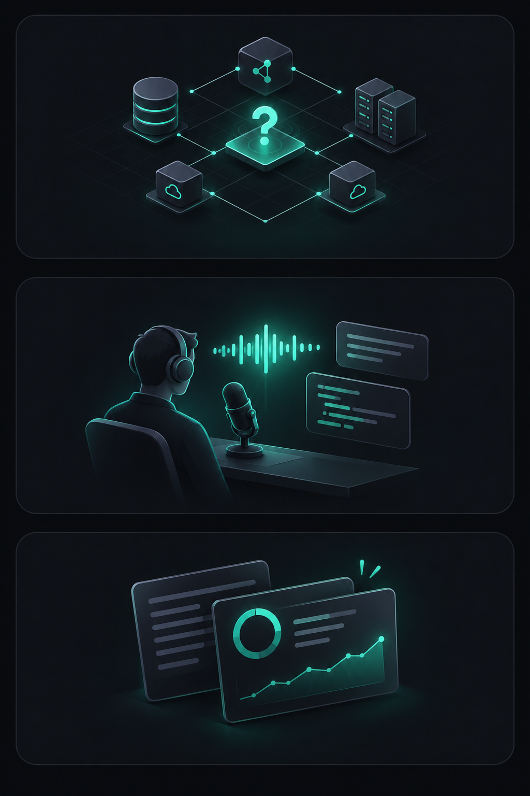

# SeniorParrot AI — Practice Workspace

An interactive workspace for practicing technical engineering interviews in English (**Senior** and **Staff** levels), focused on structured reasoning, trade-offs, communication clarity, and step-by-step review.

## Session Flow

The interface guides each practice session through three stages with empty states, a dark theme, and subtle mint accents:

1. **01 · Question (`Frontend Architecture`, `React Internals`, `System Design`, `Behavioral (STAR)`)**
   - Generates interview prompts tailored to the selected topic and seniority level.
   - Includes a collapsible `PT-BR` translation toggle while keeping the English prompt front and center.
2. **02 · Your response (Unified voice & text composer)**
   - Supports typing or voice input via the **Web Speech API**, complete with live recording feedback/waveform bars, word count, character limit indicators, and a clear-answer action.
3. **03 · Feedback & model answer (Step-by-step debrief)**
   - Breaks down evaluation into `Technical Content`, `English & Delivery`, and `Senior Model Answer`, with scoring, actionable notes, rich text formatting via `FormattedFeedbackText`, and step navigation.

## Visual Flow Concept



- **Stage 01 (Question / Architecture):** Represents scoping the problem, constraints, and system architecture.
- **Stage 02 (Response / Voice & Text):** Represents articulating the answer through speech and written notes.
- **Stage 03 (Feedback & Growth):** Represents evaluation, trade-off reflection, and a senior model answer.

## Project Structure

- `src/components/practice-workspace.tsx`: Coordinates the practice session, topic/level controls, question card, response composer, `usePracticeStore` state, and Web Speech API integration.
- `src/components/practice-feedback.tsx`: Renders the *At a glance* summary, step navigation (`01`–`03`), progress bar, and the technical, delivery, and model answer cards.
- `src/components/formatted-feedback-text.tsx`: Formats technical text and highlighted snippets.
- `src/stores/practice-store.ts`: Manages session state (`topic`, `level`, `questionIndex`, `answer`, `status`, `speechMessage`, `feedback`).

## Getting Started

```bash
npm install
npm run dev
